<p align="center">
  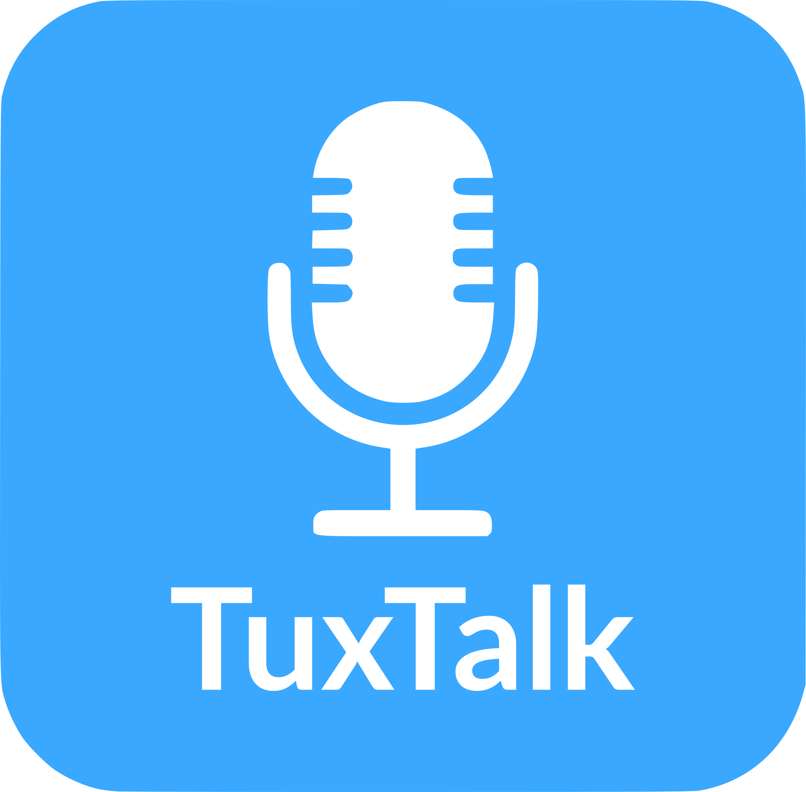
</p>

<h1 align="center">TuxTalk</h1>

<p align="center">
  <b>Hold a key, talk, let go. Your words show up wherever your cursor is.</b><br>
  Free voice dictation for Linux. It runs offline, and it works on Wayland.<br>
  <sub>TuxTalk used to be called TalkType. Same app, new name.</sub>
</p>

<p align="center">
  <a href="https://github.com/ronb1964/TuxTalk/releases/latest"></a>
  <a href="https://aur.archlinux.org/packages/tuxtalk-appimage"></a>
  <a href="LICENSE"></a>
  <a href="https://github.com/ronb1964/TuxTalk/actions/workflows/tests.yml"></a>
  
</p>

<p align="center">
  <a href="https://ronb1964.github.io/TuxTalk/"><b>Website</b></a> &nbsp;&bull;&nbsp;
  <a href="#installation">Install</a> &nbsp;&bull;&nbsp;
  <a href="#new-in-0151">New in 0.15.1</a> &nbsp;&bull;&nbsp;
  <a href="#what-it-does">What it does</a> &nbsp;&bull;&nbsp;
  <a href="#all-the-features">All the features</a> &nbsp;&bull;&nbsp;
  <a href="CHANGELOG.md">What's new</a>
</p>

<p align="center">
  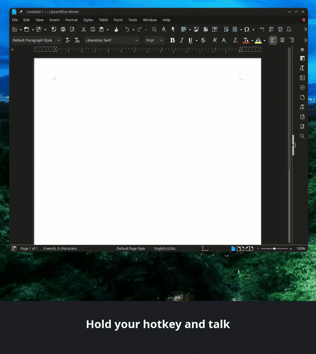
</p>

**Want to hear it too?** Here's the one-minute version, with sound (GitHub starts it muted, so click the speaker icon):

https://github.com/user-attachments/assets/ddedf92d-bbd2-4fc2-94e1-05461e633784

That works on GNOME, KDE, Sway, Hyprland and X11 with no setup, because TuxTalk reads the key straight from the keyboard instead of asking the desktop for it. Most Linux dictation tools can't do hold-to-talk on Wayland at all.

It's free, it runs completely offline, and nothing you say ever leaves your computer.

---

## New in 0.15.1

<p align="center">
  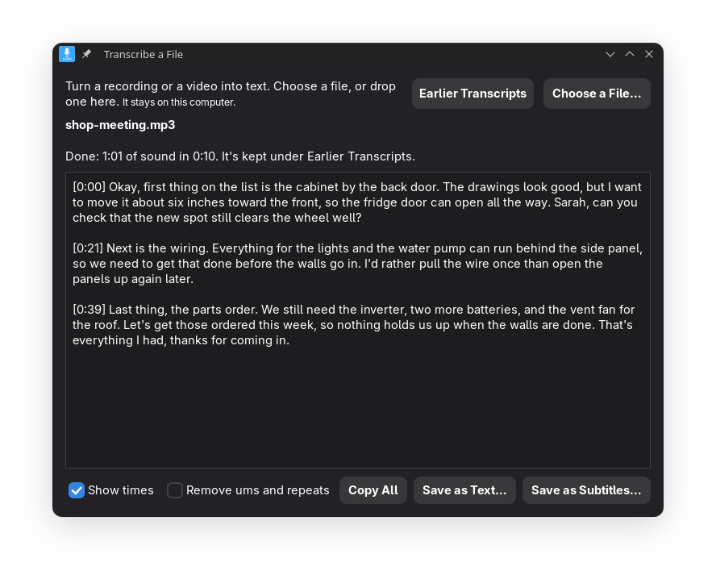
</p>

**Transcribe a File.** Give it a recording or a video and you get the text back, or subtitles for the video. It's in the tray menu right under Fix a Word. It uses the same model you dictate with, so there's nothing new to download, and dictation keeps working while it runs. On my NVIDIA card with Parakeet, three and a half minutes of talking took about nine seconds.

**Say "fix that word"** right after a dictation and Fix a Word opens on what you just said. Click the word it got wrong, type it the right way, and it's fixed in your text and in every dictation after.

**Numbers as digits**, if you want them. Parakeet likes to write "twenty-five" out in words. Tick Write numbers as digits in Preferences, Advanced and you get 25.

**Terminals get plain text.** Say "git status" into a terminal and you get git status, with no capital and no period.

And there's `tuxtalk --toggle` for your own shortcut, a way to keep auto-detect to the languages you actually speak, and select and move by voice in TuxTalk Labs. The [changelog](CHANGELOG.md) has the rest.

---

## What it does

<p align="center">
  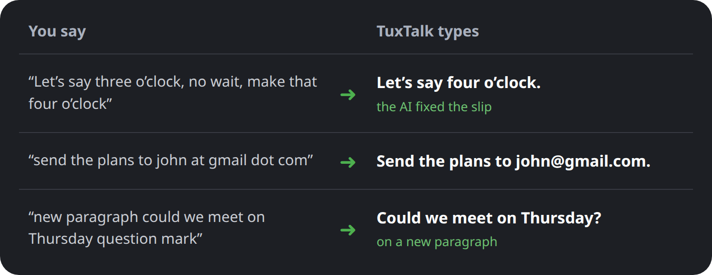
</p>

**It fixes it when you change your mind.** Say "no wait", "scratch that" or "actually" and correct yourself, and a small AI model on your own computer drops the wrong part. Every fix gets checked, and if the AI changed anything else, your words are typed exactly as you said them. It's optional, and it's off until you turn it on.

**Commands and addresses come out right.** Say "comma", "new paragraph" or "question mark" and you get the punctuation. Say an email or a web address the way you'd say it out loud and it's written the way it should be.

<table>
<tr>
<td width="50%">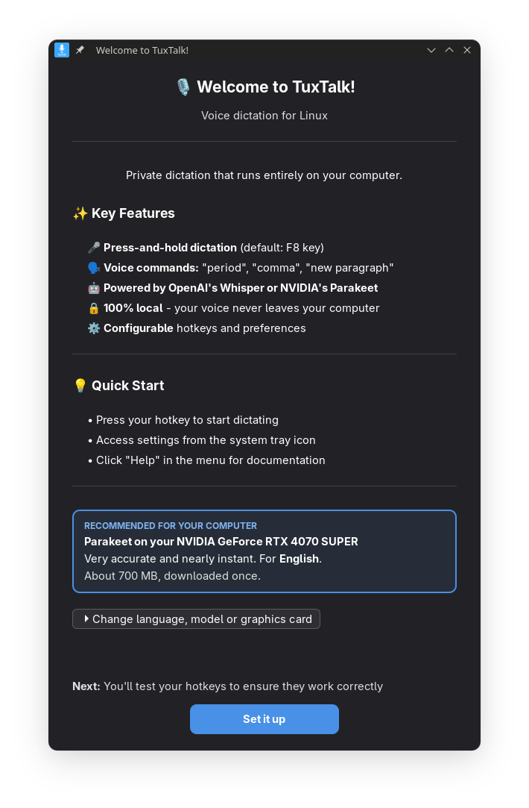</td>
<td>

### Set up for your computer

First run looks at your graphics card and your language and picks a setup for you. On a graphics card, a sentence is typed out in about a fifth of a second. No graphics card is fine too: the default model is fast on an ordinary processor.

Want something else? One button shows every choice, with what it costs you in download size and speed. Later on, **Use Recommended** in Preferences gets you back to it, and **What works with what?** shows which models run on which hardware.

</td>
</tr>
<tr>
<td>

### Teach it your words

Names, brands, the part numbers you use every day. Put them in **Your Words** and they come out spelled your way, even when the model hears them split up, like "tux talk". If one still comes out wrong, pick it out of a recent dictation with **Fix a Word**, type it the right way, and it's fixed from then on.

Snippets are your own shortcuts, like "my email" for your address.

</td>
<td width="50%">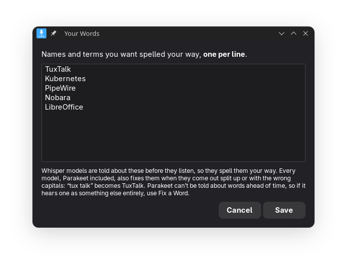</td>
</tr>
<tr>
<td width="50%">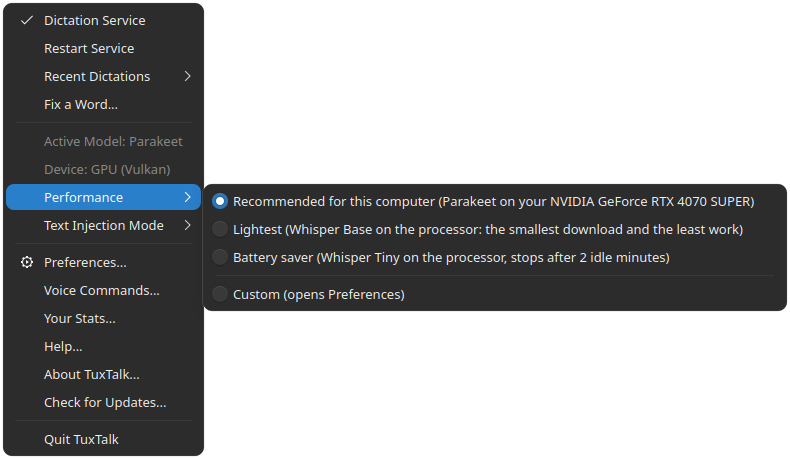</td>
<td>

### Everything from the tray

Start and stop dictation, switch between Recommended, Lightest and Battery saver, or grab one of your last 20 dictations back if the text landed in the wrong window. Those are kept in memory only and gone when you log out.

</td>
</tr>
<tr>
<td>

### See how much typing it saves you

Your Stats shows the words you've dictated today, this week and all time, and how long it would've taken to type them. Only the numbers are kept, never what you said.

</td>
<td width="50%">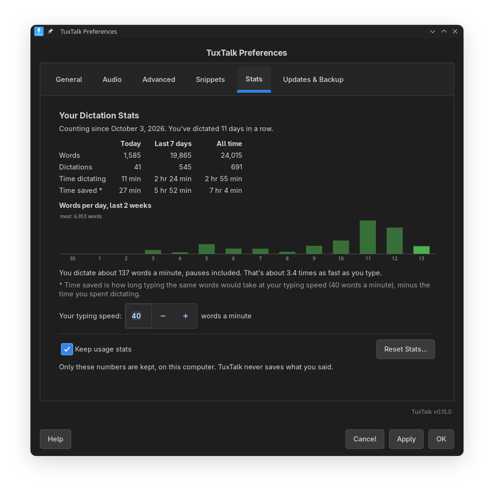</td>
</tr>
<tr>
<td width="50%">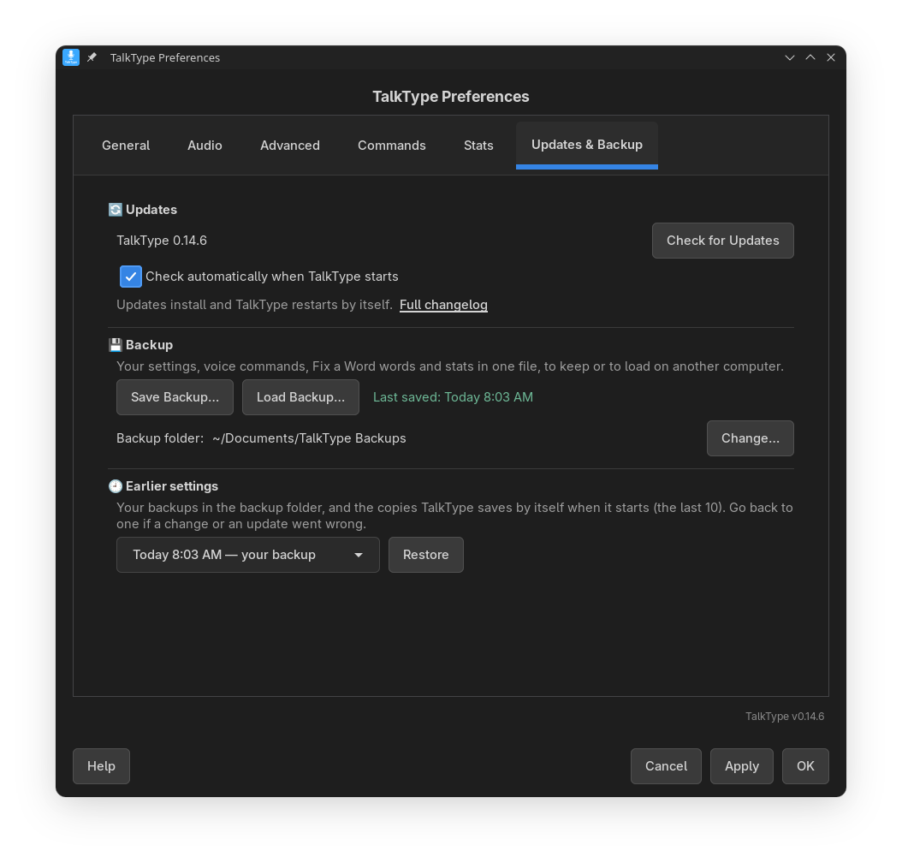</td>
<td>

### Take your setup with you

Save your settings, voice commands, Fix a Word words and stats to one file, and load it on a new computer or after a reinstall. TuxTalk also keeps your last 10 settings on its own, so if a change or an update goes wrong you can just go back.

</td>
</tr>
<tr>
<td>

### Try what's coming next

TuxTalk Labs is at the bottom of Preferences, Advanced. It's for features that work but aren't finished, like voice editing and an indicator that follows the window you're dictating into. They're off until you turn them on, and there's a link right there to tell me how they're working for you.

</td>
<td width="50%">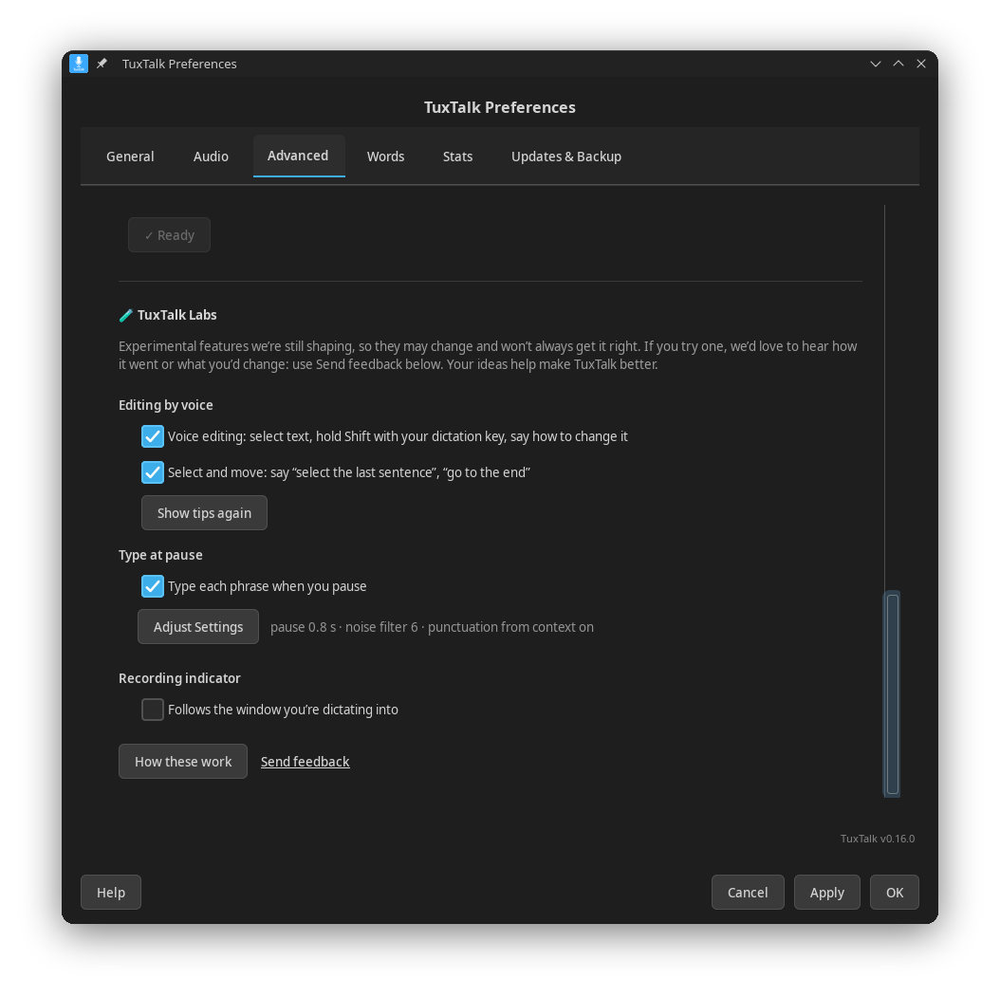</td>
</tr>
</table>

---

## Installation

### Arch Linux (AUR)

```bash
yay -S tuxtalk-appimage
# or
paru -S tuxtalk-appimage
```

Installed it and it works? A
[vote on the AUR page](https://aur.archlinux.org/packages/tuxtalk-appimage)
helps other Arch users find it — one click if you're logged in.

### Debian / Ubuntu / Linux Mint (.deb)

Download `tuxtalk_*_amd64.deb` from [Releases](https://github.com/ronb1964/TuxTalk/releases):

```bash
sudo apt install ./tuxtalk_*_amd64.deb
```

### Fedora / RHEL / openSUSE (.rpm)

Download `tuxtalk-*.x86_64.rpm` from [Releases](https://github.com/ronb1964/TuxTalk/releases):

```bash
sudo dnf install ./tuxtalk-*.x86_64.rpm
```

Both packages install to `/opt/talktype` (the folder kept its old name so
upgrades from TalkType replace files in place), add a `tuxtalk` command and an
Applications menu entry, and pull in the few system libraries they need.

### AppImage (All Distros)

Download the latest AppImage from [Releases](https://github.com/ronb1964/TuxTalk/releases):

```bash
chmod +x TuxTalk-v*.AppImage
./TuxTalk-v*.AppImage
```

The AppImage includes everything needed - just download and run!

> **Note:** The AppImage doesn't need libfuse2 anymore. It does need `fusermount`, which nearly every desktop already has. If it won't start, install the `fuse3` package:
> - **Fedora/RHEL**: `sudo dnf install fuse3`
> - **Ubuntu/Debian**: `sudo apt install fuse3`
> - **Arch/Manjaro**: `sudo pacman -S fuse3`
> - **openSUSE**: `sudo zypper install fuse3`

### Flatpak

There's a sandboxed Flatpak build in `packaging/flatpak`, but it isn't published
for download yet, and it hasn't been rebuilt since the rename to TuxTalk.
**Want a Flatpak version?**
👉 **[Vote in the poll](https://github.com/ronb1964/TuxTalk/discussions/6)** —
enough interest and I'll make it happen.

### System Requirements

| Requirement | Details |
|------------|---------|
| **OS** | Linux, on Wayland or X11 (GNOME, KDE, Sway, Hyprland and more) |
| **Dependencies** | None to install by hand — ydotool, ydotoold and wl-clipboard ship inside TuxTalk, and the ydotoold daemon starts automatically on first run |
| **Permissions** | First run asks for your admin password once, to let TuxTalk read your keyboard and type into other apps. **Restart afterwards** for it to take effect |
| **Audio** | Working microphone |
| **GPU (optional)** | Any NVIDIA, AMD or Intel graphics chip (Vulkan), or CUDA on NVIDIA |

---

## Quick Start

1. **Launch TuxTalk** - Run the AppImage or use your app launcher
2. **First-run setup** - TuxTalk will guide you through initial configuration
3. **Start dictating** - Press **F8** (hold to record) or **F9** (tap to toggle) — both always active
4. **Speak naturally** - Text appears where your cursor is
5. **Use voice commands** - Say "comma", "period", "new line", etc.

### Hotkeys (Both Always Active)

| Hotkey | How it works |
|--------|--------------|
| **F8** | Hold to record, release to transcribe (hold-to-talk) |
| **F9** | Press once to start, press again to stop (tap-to-toggle) |
| **Ctrl+Alt+P** | Types your last dictation again, wherever your cursor is |
| **Shift+F8** | Voice editing: hold it and say how to change the selected text (turn it on in TuxTalk Labs first) |

Want your own shortcut, or a script? Run `tuxtalk --toggle` (or `--start`, `--stop`). For the AppImage, use the AppImage file, e.g. `~/AppImages/TuxTalk.AppImage --toggle`. It starts TuxTalk if it isn't running and waits for the speech model to load, so the toggle is never lost.

---

## All the features

- **Two hotkeys, both always on.** Hold F8 to talk, or tap F9 to start and tap again to stop. Pick any keys you like.
- **Hands-free if you want it.** Double-tap F9, talk, and it stops by itself when you go quiet. A single tap still works as a plain on/off switch, so a long dictation with thinking pauses never gets cut off. Say nothing for 10 seconds and it stops without typing anything.
- **Your choice of speech model.** NVIDIA's Parakeet is the default: fast on any processor, for English and 24 European languages. OpenAI's Whisper covers 99 languages, from Tiny up to Large-v3. Not sure which? **What works with what?** in Preferences lays it out.
- **Only these languages.** Tick the languages you actually speak and Whisper's auto-detect sticks to those.
- **Any graphics card.** NVIDIA, AMD or Intel through Vulkan, a 24 MB download. On NVIDIA you can use CUDA instead. TuxTalk times your graphics chip against your processor first and only uses it if it's really faster.
- **Corrections.** Say "no wait", "scratch that", "I mean" or "actually" and the optional AI fixes it. It also drops "um", "uh" and stutters.
- **Voice commands.** "comma", "period", "new paragraph", "undo last word", "delete last three sentences" and more. See the full list below.
- **Email and web addresses.** "john at gmail dot com" types john@gmail.com, and "github dot com" types github.com.
- **Numbers as digits, if you want them.** 25 instead of twenty-five, and 7:30 and 15th too. Works in English and seven other languages.
- **Plain text in terminals.** No capital at the start and no period at the end when you dictate a command.
- **Voice editing (Labs).** Select text, hold Shift+F8 and say how to change it. Tone and rewrites go to the AI, while caps, lists, commas and removing a word are done exactly in code. Bold, italics and underline work in LibreOffice and other word processors.
- **Select and move by voice (Labs).** Say "select the last sentence" or "go to the end" on its own and TuxTalk does it instead of typing it.
- **Snippets.** Make a phrase type anything you want, like "my email" for your address.
- **Your Words.** The names and terms you use, spelled your way.
- **Fix a Word.** Teach it a name or term it keeps getting wrong. Or just say "fix that word" right after a dictation.
- **Paste Last Dictation.** Ctrl+Alt+P types your last dictation again, for when it landed in the wrong window.
- **Transcribe a File.** Turns a recording or a video into text or subtitles with the same model you dictate with, and keeps your last 10.
- **Pauses your music and videos** while you talk, and starts back up only what it paused.
- **Recent Dictations.** Your last 20, one click to copy. Kept in memory only.
- **Your Stats.** Words dictated and typing time saved, at your own typing speed.
- **Settings backup.** Save everything to one file and load it on another computer. TuxTalk also keeps your last 10 settings on its own, so you can roll back a change.
- **A recording indicator you can style.** Orb, waveform, frequency bars or radial, any color, anywhere on screen. It reacts to your voice so you know it's listening. In Labs it can follow the window you're dictating into.
- **Swiss German spelling.** Types ss instead of ß, on by itself when your system is set to Swiss German.
- **Tells you why when it can't type.** If a dictation can't be typed into the window, TuxTalk says why and what fixes it.
- **Private.** Everything runs on your computer, and what you dictate is never written to a log unless you turn that on for troubleshooting.
- **GNOME extension.** A native panel menu on GNOME, and a tray icon everywhere else.
- **Updates the right way.** Through your package manager for the .deb and .rpm, in place for the AppImage, or through your AUR helper on Arch.

---

## More

<details>
<summary><b>More screenshots</b></summary>

<p align="center">
  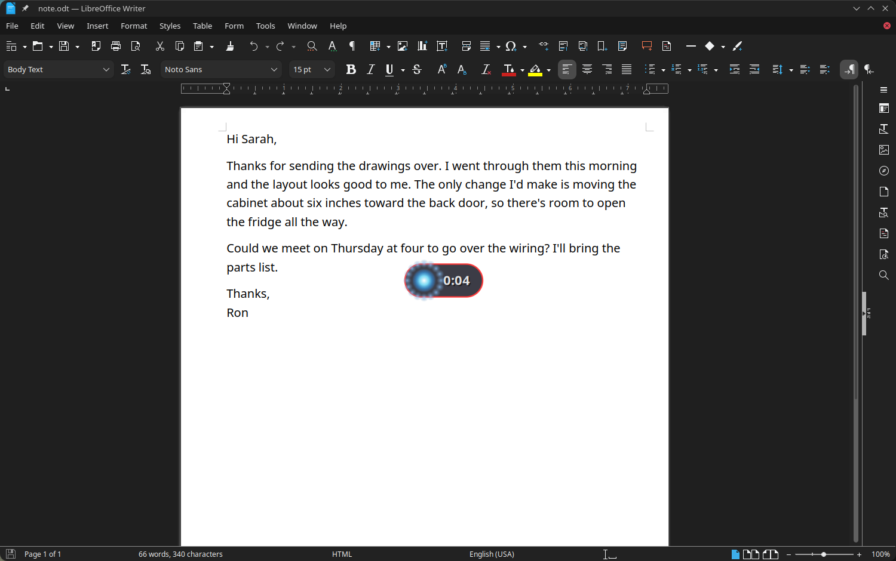
</p>
<p align="center"><em>Hold F8 and talk: the indicator shows TuxTalk is listening, and your words land wherever you're typing</em></p>

<p align="center">
  
  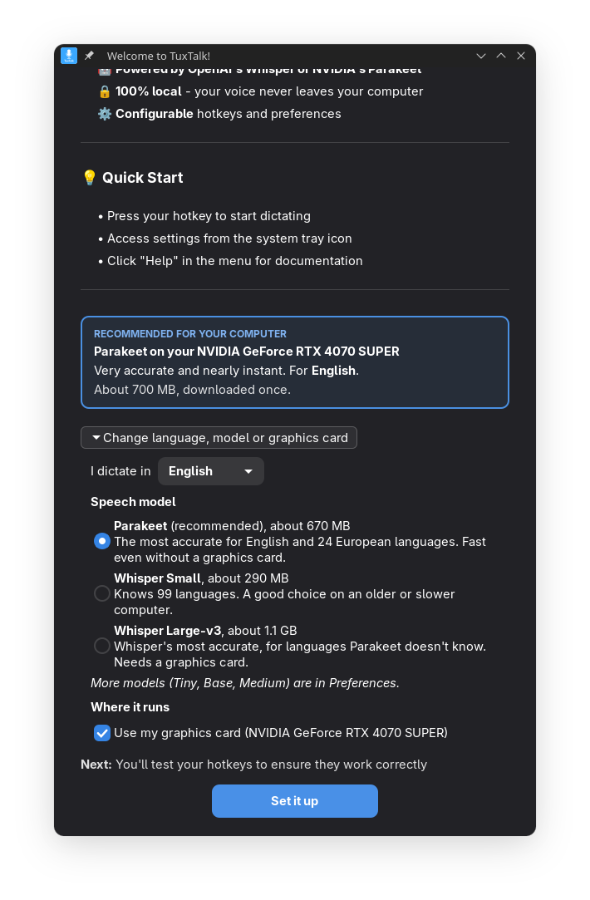
</p>
<p align="center"><em>First run recommends a setup &bull; one button shows every choice</em></p>

<p align="center">
  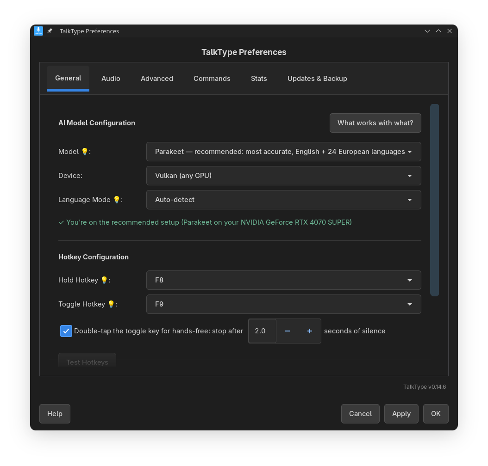
  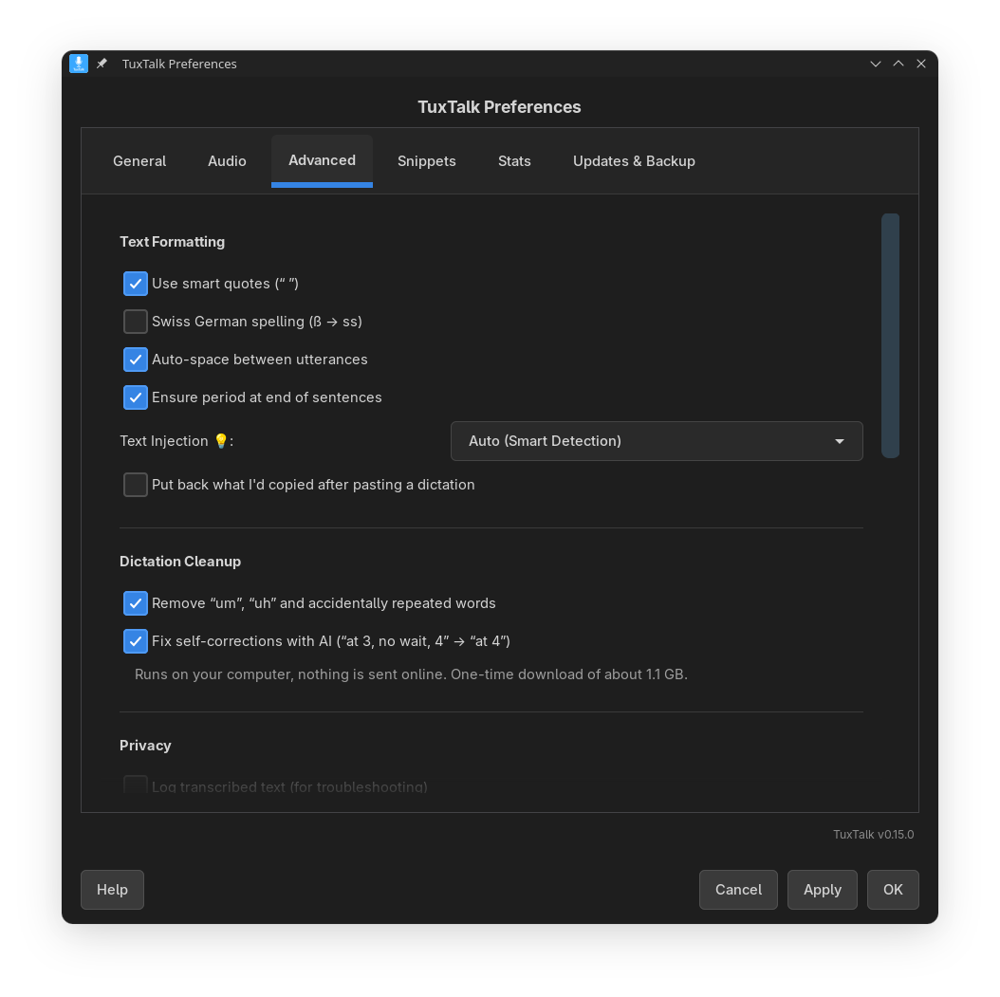
</p>
<p align="center"><em>Model, graphics card and hotkeys &bull; Dictation cleanup and AI self-corrections</em></p>

<p align="center">
  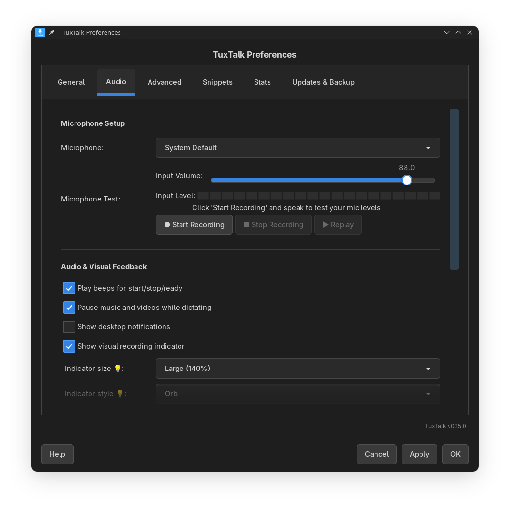
  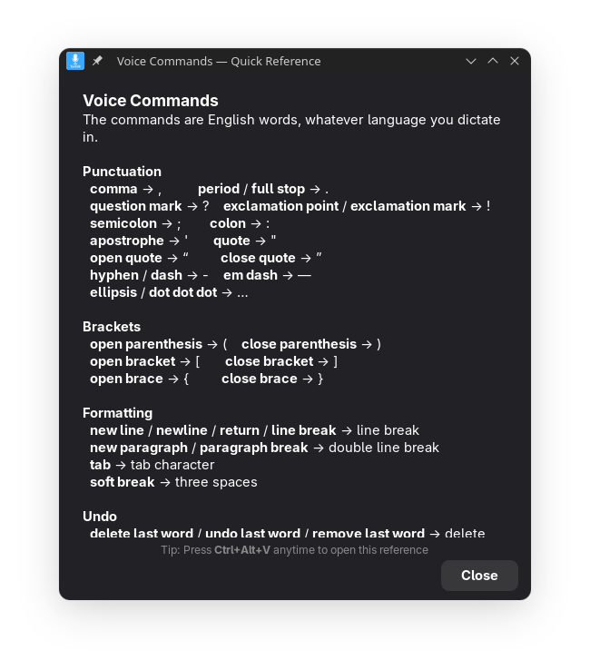
</p>
<p align="center"><em>Microphone test and recording indicator &bull; The Voice Commands quick reference</em></p>

<p align="center">
  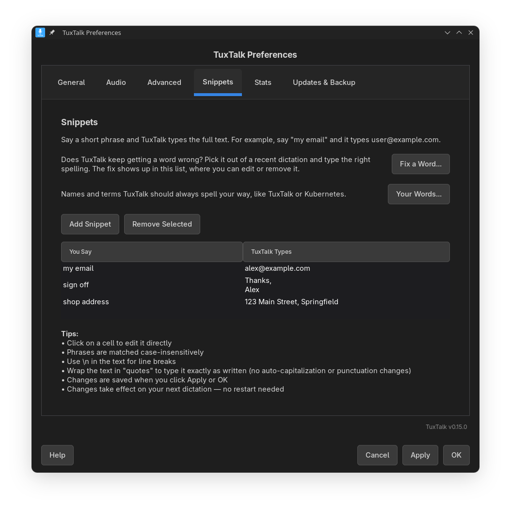
  
</p>
<p align="center"><em>Snippets, Fix a Word and Your Words &bull; Your Stats</em></p>

<p align="center">
  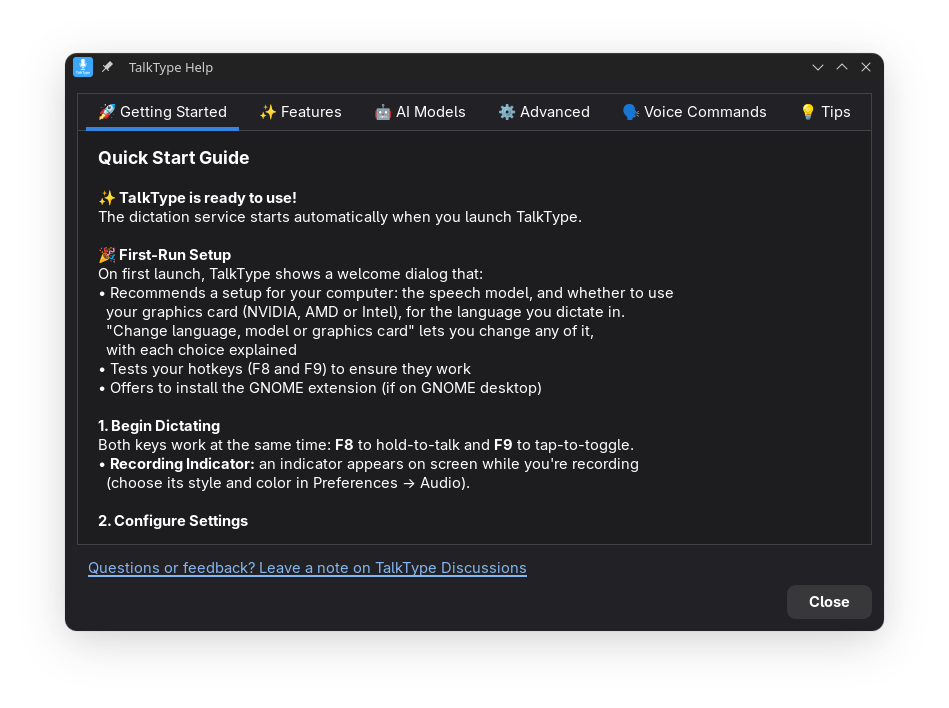
</p>
<p align="center">
  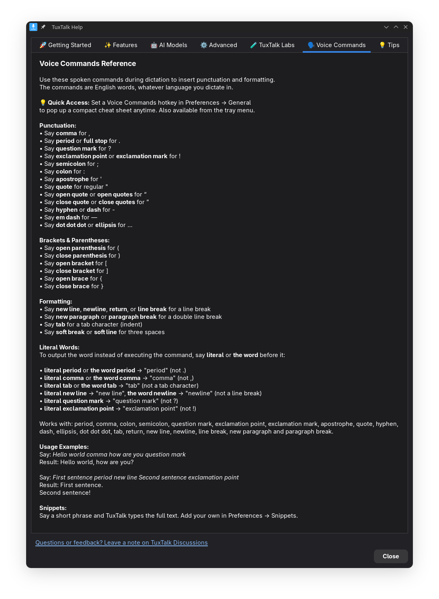
  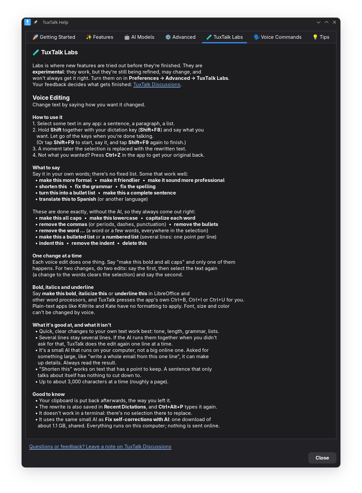
</p>
<p align="center"><em>Built-in help, including a page on TuxTalk Labs and voice editing</em></p>

</details>

<details>
<summary><b>Voice commands, the full list</b></summary>

### Punctuation
| Say This | Result |
|----------|--------|
| "comma" | , |
| "period" / "full stop" | . |
| "question mark" | ? |
| "exclamation point" | ! |
| "colon" | : |
| "semicolon" | ; |
| "open quote" / "close quote" | " " (smart quotes) |
| "dot dot dot" / "ellipsis" | ... |

### Formatting
| Say This | Result |
|----------|--------|
| "new line" | Line break |
| "new paragraph" | Double line break |
| "tab" | Tab character |

### Editing
| Say This | Result |
|----------|--------|
| "undo last word" | Deletes the last word |
| "undo last sentence" | Deletes to the previous sentence |
| "undo last paragraph" | Deletes the last paragraph |
| "delete last three words" | Deletes several at once — words, sentences or paragraphs |
| "delete last 5 sentences" | Digits work too; counts above what you dictated are clamped |
| "clear everything" | Clears the **entire** input field (see warning below) |

**Undo, delete and remove are interchangeable** — say whichever comes naturally
("delete last word", "remove last two sentences"). Counts accept digits or the
words one through ten.

> ⚠️ **"clear everything" empties the whole field, not just what you dictated.**
> The phrases *undo/delete/clear* + *everything/all* — six in total — all do the
> same thing: select all and delete. That includes text you typed yourself, so
> it is not limited to the current dictation.

### Literal Words
Say **"literal"** before any command to output the word instead:
- "literal comma" → types "comma" (not ,)
- "literal period" → types "period" (not .)

</details>

<details>
<summary><b>Speech models</b></summary>

Choose the right model for your needs in Preferences → General:

| Model | Size | Speed | Accuracy | Best For |
|-------|------|-------|----------|----------|
| **tiny** | 78 MB | Fastest | Basic | Quick notes |
| **base** | 148 MB | Fast | Good | Casual use |
| **small** | 486 MB | Balanced | Very Good | Any of 99 languages |
| **medium** | 1.5 GB | Slower | Excellent | Professional |
| **large-v3** | 3.1 GB | Slowest | Best | Technical work |
| **Parakeet** | 670 MB | Fast, even without a GPU | Best | **Recommended** for English + 24 European languages |

> **Tip:** First run recommends a setup for your computer and language. **Use Recommended** in Preferences → General, or tray → Performance → **Recommended for this computer**, puts you back on it any time.
> **Parakeet** is the default. It's a different engine that NVIDIA made, and it runs on your processor (or on your graphics card through Vulkan). It doesn't cover Chinese, Japanese, Korean, Arabic and other non-European languages. For those, first run picks Whisper: Small on the processor, or Large-v3 on a graphics card.

</details>

<a name="graphics-cards"></a>
<details>
<summary><b>Graphics cards</b></summary>

A graphics card makes the Whisper models much faster, and with Vulkan it speeds up Parakeet too. There are two ways to use one:

| | Works on | Download | Pick it in |
|---|---|---|---|
| **Vulkan (Light)** | NVIDIA, AMD and Intel | 24 MB | Preferences → General → Device → Vulkan (any GPU) |
| **CUDA (Full)** | NVIDIA only | 1.4 GB | Preferences → General → Device → CUDA (NVIDIA) |

On an RTX 4070 Super both were equally fast: half a second for 11 seconds of speech with the Large model. First run uses any graphics card through Vulkan. CUDA is set up from Preferences by choosing it as the Device.

Before switching to Vulkan, TuxTalk times your graphics chip against your processor and only switches if the graphics chip is clearly faster. The graphics built into some desktop processors is too small to help, and in that case it tells you and keeps using the processor.

Parakeet doesn't need a graphics card, since it's already fast on the processor. With the device set to Vulkan it runs on the graphics card anyway: on an RTX 4070 Super, a minute of speech took 0.2 seconds instead of 2, with the same accuracy. That needs a second copy of Parakeet in the graphics engine's format (669 MB). The processor copy stays too, as a fallback. CUDA can't run Parakeet.

</details>

<details>
<summary><b>Settings file</b></summary>

Settings are stored in `~/.config/tuxtalk/config.toml`. To keep a copy, use **Save Backup** in Preferences → Updates & Backup.

```toml
model = "parakeet-v3"     # AI model: parakeet-v3, tiny, base, small, medium, large-v3
device = "cpu"            # "cpu", "vulkan" (any GPU) or "cuda" (NVIDIA)
hotkey = "F8"             # Hold-to-talk key (hold to record, release to stop)
toggle_hotkey = "F9"      # Tap-to-toggle key (press once start, press again stop)
# Both hotkeys are always active simultaneously
language_mode = "auto"    # "auto", or "manual" to use the language below
language = ""             # language code for manual mode, e.g. "de"
beeps = true              # Audio feedback sounds
smart_quotes = true       # Use curly quotes " "
auto_space = true         # Auto-space between utterances
auto_period = true        # Add period at end of sentences
```

</details>

<details>
<summary><b>Troubleshooting</b></summary>

### Text not appearing?
- Check ydotoold is running: `pgrep -a ydotoold` (TuxTalk starts it for you)
- Verify socket exists: `ls $XDG_RUNTIME_DIR/.ydotool_socket`

### Hotkey not working?
- Another app may be using F8/F9 - try different keys in Preferences
- Ensure TuxTalk service is running (check tray icon)

### No hotkey works at all?
On Wayland a normal program isn't allowed to see keys pressed in other
windows, so TuxTalk needs a little help to notice F8.

- Preferences → Advanced → Typing Setup → **Fix Typing Permissions**
- On most systems that installs TuxTalk's hotkey helper. It's a small
  background service, and it's the only thing that reads the keyboard. It
  tells TuxTalk about its hotkeys and nothing else, so no other program you
  run gets to read what you type. No restart needed. Check it with
  `systemctl status tuxtalk-hotkeys`
- On a system without systemd it puts you in the `input` group instead. Then
  restart the computer (logging out often isn't enough) and check with
  `groups`

### Why is there a hotkey helper service?
Older versions put you in the `input` group. That works, but the group lets
every program you run read every key you press, passwords too. The helper
fixes that. It runs as a throwaway system user with no network and no access
to your files, it never reports a letter or a number, only F-keys, Esc and
shortcuts with Ctrl, Alt or Super, and only to whoever's at the screen.
`systemd-analyze security tuxtalk-hotkeys` rates it 0.6, "SAFE".

To type, TuxTalk still needs `/dev/uinput`, so whoever's at the screen gets
it, the same rule Steam uses for game controllers. A program can use it to
press keys but not to read them. To take the helper off again:

```bash
sudo systemctl disable --now tuxtalk-hotkeys
```

```bash
sudo rm -r /etc/systemd/system/tuxtalk-hotkeys.service /etc/udev/rules.d/70-tuxtalk-uinput.rules /usr/local/libexec/tuxtalk
```

### Transcription slow?
- Use your graphics card if you have one (see [Graphics cards](#graphics-cards) above)
- Try Parakeet, or a smaller Whisper model (tiny or base)
- Tray menu → Performance → Recommended for this computer

### Tray icon not visible (GNOME)?
- TuxTalk offers to install its GNOME extension on first run
- Or manually: Preferences → Advanced → Install Extension

</details>

<details>
<summary><b>Building from source</b></summary>

### From Source

GTK's Python bindings can't be installed with pip, so they come from your
system and the rest goes in a venv. `run-dev.sh` puts the two together.

```bash
# Prerequisites (Fedora/Nobara; other distros have the same packages under similar names)
sudo dnf install -y portaudio-devel ydotool wl-clipboard \
                    python3-gobject libayatana-appindicator-gtk3 libnotify

# Clone and install
git clone https://github.com/ronb1964/TuxTalk.git
cd TuxTalk
python3 -m venv .venv
.venv/bin/pip install poetry
.venv/bin/poetry install

# Run
./run-dev.sh
```

You don't need to set up ydotoold yourself. TuxTalk starts it when it needs it.

To run the tests (swap in your Python version, `python3 --version` shows it):

```bash
PYTHONPATH=./src:/usr/lib64/python3.14/site-packages:/usr/lib/python3.14/site-packages \
    .venv/bin/python -m pytest tests -q
```

More in [DEV_SETUP.md](DEV_SETUP.md).

</details>

---

## License

MIT License. See [LICENSE](LICENSE) for details.

TuxTalk's downloads also include other open-source software, like ydotool and wl-clipboard, each under its own license. [THIRD_PARTY_LICENSES.md](THIRD_PARTY_LICENSES.md) lists them.

<p align="center">
  <a href="https://github.com/ronb1964/TuxTalk/releases/latest">Download</a> &bull;
  <a href="CHANGELOG.md">Changelog</a> &bull;
  <a href="https://github.com/ronb1964/TuxTalk/issues">Report a bug</a> &bull;
  <a href="https://github.com/ronb1964/TuxTalk/discussions">Ideas and questions</a>
</p>
